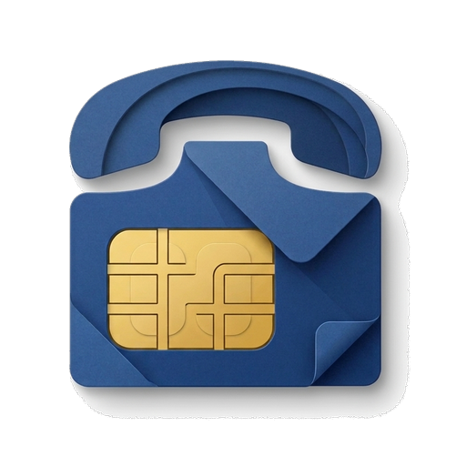
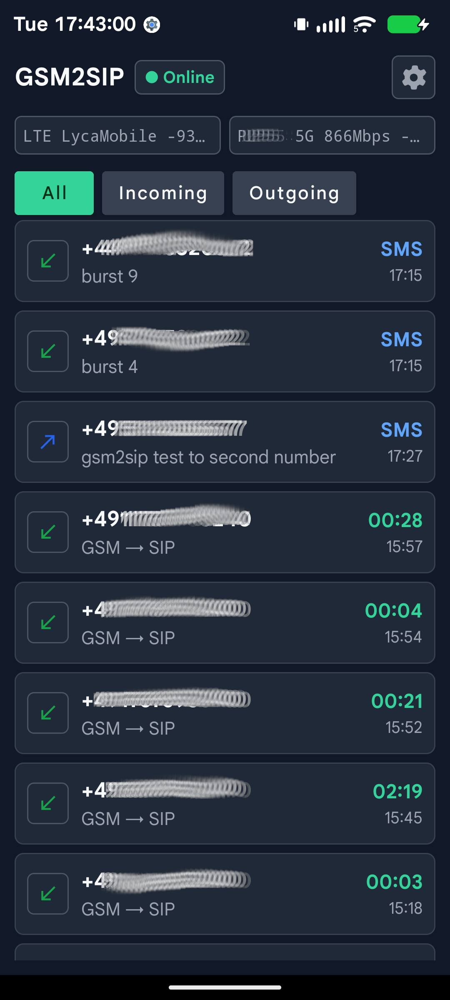
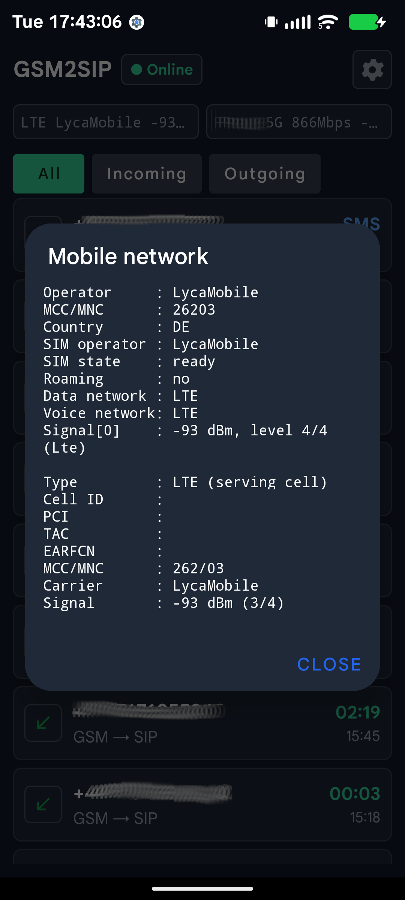
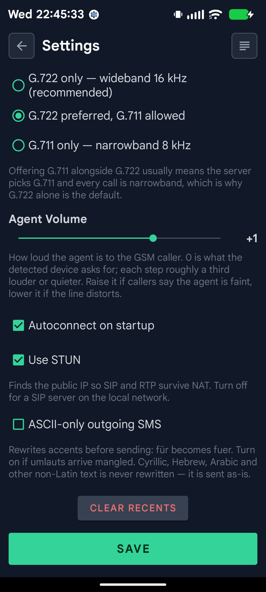

<p align="center">
  
</p>

<h1 align="center">gsm2sip</h1>

<p align="center">Use an Android phone and its SIM as a SIP ↔ GSM gateway.</p>

<p align="center">
  <strong>English</strong> · <a href="../ru/README.md">Русский</a><br>
  <a href="https://github.com/e-u-shapovalov/gsm2sip/releases/latest">Download</a> ·
  <a href="#getting-started">Setup</a> ·
  <a href="../xiaomi-mi6-msm8998.md">Mi 6 technical notes</a> ·
  <a href="https://github.com/pulpoff/gsm2sip">Original project</a>
</p>

Connect a rooted Android phone to your PBX to receive and place calls through
its SIM. Forward SMS over SIP, or connect to
[goip-bridge](https://github.com/e-u-shapovalov/goip-bridge) for SMS and USSD
through an HTTP API, webhooks and an optional MySQL queue.

## What this fork adds

This is an independently maintained fork of
[pulpoff/gsm2sip](https://github.com/pulpoff/gsm2sip), with its own version
sequence starting at **1.0.0**. The additions focus on Xiaomi Mi 6, GoIP
integration and SMS callbacks.

| Addition | What it changes |
|---|---|
| **Xiaomi Mi 6 audio profile** | Digital audio in both directions through the `mi6bridge` root helper and ALSA, bypassing the Android audio path on the tested ROM. |
| **G.711 A-law encoder fix** | Corrects distortion when encoding low-level PCM samples for the GSM → SIP direction. |
| **Mi 6 handset microphone muting** | Reduces room pickup during a call by lowering DEC7/DEC8 gain; restores it when the call ends. |
| **SMS and USSD over GoIP** | Makes the phone a line on a GoIP SMS server, alongside hardware GoIP gateways. |
| **SMS callback** | `+++number+++` calls the sender back and connects them to `cb<number>` on the PBX. An echo test can use the same mechanism. |
| **Android 15 permission fixes** | Handles `appId=` in package output, checks UID AppOps and leaves PermissionController enabled. |
| **SIP and routing fixes** | Refreshes registration using the registrar's expiry, supports a fixed `local_ip` and uses the sole SIM when the PBX Caller ID does not match its number. |
| **Multi-value mixer writes** | The bundled `tinymix` can write all elements of a control in one operation. |

The maintained setup is a **Xiaomi Mi 6, LineageOS 22.2 / Android 15, Magisk,
VoLTE and an Asterisk-based PBX**. Calls in both directions, G.711 A-law,
SMS, callbacks and operation over LTE have been tested in this setup.
Device-specific observations are recorded in the [Mi 6 notes](../xiaomi-mi6-msm8998.md).

## How it works

```text
Mobile caller ↔ mobile network ↔ Android phone + SIM ↔ SIP / RTP ↔ PBX
                                      ↕                          ↕
                                  SMS / USSD              Extension, IVR,
                                      ↕                   queue or trunk
                                 goip-bridge
                                      ↕
                             HTTP API / webhook / MySQL
```

- **Incoming call:** the SIM rings, the gateway calls the PBX and answers the
  mobile call when the PBX answers. The PBX decides where to route it.
- **Outgoing call:** the PBX sends a destination number to the gateway, which
  dials it through the SIM and bridges the audio after the mobile party answers.
- **Messages:** incoming SMS use SIP MESSAGE by default. Configuring a GoIP
  line sends incoming SMS through goip-bridge and enables its SMS/USSD commands.

Audio routing depends on the device profile. On Mi 6, `mi6bridge` captures
the modem downlink and injects SIP audio into the voice uplink through ALSA.

<details>
<summary>App screenshots</summary>

Screenshots from the original project; some labels differ in this fork.

| Calls and messages | Mobile network | Settings |
|:---:|:---:|:---:|
|  |  |  |

</details>

## Devices and requirements

| Device | Platform | Verification |
|---|---|---|
| **Xiaomi Mi 6** (`sagit`) | MSM8998 / WCD9335, LineageOS 22.2 | Tested in this fork with VoLTE and G.711 A-law; raw ALSA audio in both directions. |
| Xiaomi Poco X3 NFC (`surya`) | SM6150 / SM7150 | Reported working by upstream, including G.722 and digital audio in both directions; not re-tested here. |
| Samsung Galaxy S4 Mini (`serranolte`) | MSM8960 / WCD9304, LineageOS 16 | Reported working by upstream; not re-tested here. |
| Samsung Galaxy S10e | Exynos 9820 | Upstream found no usable digital call-audio path on the tested firmware. |

Support depends on the phone's firmware and audio routing, as well as its
chipset. Another phone with the same chipset may need a different profile.
To inspect a candidate device:

```sh
bash tools/check-device.sh [adb-serial]
```

The audio-policy check works without root; HAL and mixer checks require root.
The app's minimum Android version is 8.0 (API 26), which alone does not establish
device compatibility.

You need Magisk root, the gateway Magisk module, a SIM with the required voice
and SMS services, power for continuous use, and a network path to the PBX.

### Using LTE without Wi-Fi

SIP and VoLTE can share the same SIM's LTE connection. In the recorded Mi 6
test, a 76-second call stayed on LTE and all 77 ping requests received replies.
Wi-Fi or Ethernet can also carry SIP traffic.

For operation entirely over LTE, VoLTE must actually be available on the
phone, SIM and serving network. Falling back to circuit-switched voice can
interrupt mobile data and the SIP connection. Check this during a real call;
enabling a setting alone does not establish VoLTE support.

## Getting started

1. Download **[gateway-magisk.zip](https://github.com/e-u-shapovalov/gsm2sip/releases/latest/download/gateway-magisk.zip)**
   from this fork's [releases](https://github.com/e-u-shapovalov/gsm2sip/releases).
2. Install the ZIP through Magisk → Modules, then reboot. It includes the APK,
   privileged permissions and audio helpers.
3. Set **gsm2sip** as the default phone app in Android settings.
4. Open the app's settings and enter the SIP server, port, username and password.
5. Set **Own Number** to the SIM's number in international format, such as
   `+4915112345678`. The PBX must route this number to the intended destination.
6. On **Mi 6**, select **G.711 only** and allow `alaw` on the PBX to reproduce the
   tested setup. Save and start the gateway; **Online** indicates SIP registration.

Leaving Own Number unset can make the gateway call its own SIP account and
create a routing loop. On a multi-SIM phone, configure each SIM's own number.

The separate **[gateway.apk](https://github.com/e-u-shapovalov/gsm2sip/releases/latest/download/gateway.apk)**
is for updating an existing module installation:

```sh
adb -s <serial> install -r gateway.apk
```

This requires a matching signing key. It updates the app, but does not update
the module's scripts or native helpers; install the new module and reboot for
a complete update. A standalone APK install does not provide the module's
privileged setup.

### Audio codecs

| App setting | SDP payloads | Use |
|---|---|---|
| G.722 only — app default | `9` | Wideband audio on a device with a working 16 kHz path. |
| G.722 preferred, G.711 allowed | `9 8 0` | Offers both; the PBX may choose G.711. |
| G.711 only | `8 0` | PCMA / PCMU; the verified Mi 6 setup uses PCMA (A-law). |

G.722 remains available in the code; the Mi 6 results documented here do not
establish its audio quality on that device.

## Connecting your PBX

For incoming mobile calls, the gateway places the SIM's **Own Number** in the
SIP Request-URI and `To`, and the mobile caller's number in `From`. Normalise
caller numbers on the PBX if your routing needs a consistent format.

For outgoing mobile calls, put the destination in the Request-URI or the
`X-GSM-Forward` header. The header takes precedence. The gateway ignores its
own SIP account and SIM number as URI destinations to avoid loops.

<details>
<summary>Asterisk example — chan_sip</summary>

This example uses `chan_sip` syntax. Adapt the account, numbers and routing to
your PBX; a PJSIP configuration needs its own endpoint and header handling.

`sip.conf`:

```ini
[gateway-gw1]
type=peer
host=dynamic
secret=<strong-password>
context=gateway-incoming
; From carries the mobile caller; restrict access to the gateway's network.
insecure=port,invite
disallow=all
allow=alaw
```

`extensions.conf` — send calls to the SIM's number to extension `100`:

```ini
[gateway-incoming]
exten => +4915112345678,1,Dial(SIP/100,60)
 same => n,Hangup()
```

In a context available to authorised PBX users, dial through the gateway:

```ini
exten => _X.,1,Dial(SIP/gateway-gw1/${EXTEN},60)
 same => n,Hangup()
exten => _+X.,1,Dial(SIP/gateway-gw1/${EXTEN},60)
 same => n,Hangup()
```

If the number must be supplied separately, `chan_sip` can use:

```ini
same => n,SIPAddHeader(X-GSM-Forward: ${EXTEN})
same => n,Dial(SIP/gateway-gw1,60)
```

</details>

### Call progress

| Outgoing mobile call | Gateway's SIP response |
|---|---|
| INVITE received / dialling | `100 Trying` / `180 Ringing` |
| Mobile party answers | `200 OK`, then audio |
| Busy / declined | `486 Busy Here` / `603 Decline` |
| No answer or unreachable | `480 Temporarily Unavailable` |
| Cancelled at the handset / barred number | `487 Request Terminated` / `403 Forbidden` |
| Gateway already busy / no usable destination | `486 Busy Here` / `488 Not Acceptable Here` |

On incoming mobile calls, `100`, `180` and `183` from the PBX keep the SIM
ringing. `200 OK` answers it; a final 4xx–6xx response ends the mobile call.

## SMS and USSD through goip-bridge

[goip-bridge](https://github.com/e-u-shapovalov/goip-bridge) is a separate server
for GoIP SMS lines. The phone speaks its UDP protocol and appears as another
line alongside hardware gateways. The server provides the HTTP API and
webhooks; MySQL storage and queues are optional.

These settings are currently stored in
`/data/user/0/com.callagent.gateway/shared_prefs/gateway.xml`, with no GoIP
settings screen. Stop the app before editing the file with root, preserve the
existing settings and file ownership, then reopen the app.

| Key | XML type | Example | Meaning |
|---|---|---|---|
| `goip_server` | `string` | `192.168.1.10` | GoIP server address. |
| `goip_port` | `int` | `44444` | UDP port. |
| `goip_line` | `string` | `Mi6` | Line identifier on the server. |
| `goip_pass` | `string` | Your line password | Must match the server's line configuration. |
| `local_ip` | `string` | A local interface address | Optional source address shared with SIP, for example on a routed tunnel. |

XML entries inside the existing `<map>` element:

```xml
<string name="goip_server">192.168.1.10</string>
<int name="goip_port" value="44444" />
<string name="goip_line">Mi6</string>
<string name="goip_pass">replace-with-line-password</string>
```

With `goip_server` and `goip_line` set, incoming SMS wait for GoIP delivery;
there is no automatic fallback to SIP when that server is unavailable.
Leave GoIP unconfigured to use SIP MESSAGE. The current GoIP path uses Android's
default SMS subscription and does not expose per-line SIM selection.

The GoIP UDP protocol carries credentials and message content in plain text.
Use a trusted network or a VPN for this connection.

Run these API examples on the goip-bridge host, using its HTTP token:

```sh
# Send an SMS through the phone's SIM.
curl -X POST http://127.0.0.1:8080/sms \
  -H 'Authorization: Bearer <http_token>' \
  -H 'Content-Type: application/json' \
  -d '{"line":"Mi6","to":"+4915112345678","text":"Hello"}'

# Request the balance, if the operator uses this USSD code.
curl -X POST http://127.0.0.1:8080/ussd \
  -H 'Authorization: Bearer <http_token>' \
  -H 'Content-Type: application/json' \
  -d '{"line":"Mi6","code":"*100#"}'
```

Incoming SMS and delivery reports can reach your application through webhooks.
With MySQL enabled, the server also stores messages and processes queued jobs.
See the [goip-bridge API](https://github.com/e-u-shapovalov/goip-bridge/blob/main/API.md)
for response formats and synchronous versus queued operation. USSD availability
depends on the phone and operator.

## SMS callback and echo test

Send `+++401+++` to the gateway SIM to request a callback:

1. The SMS is queued for normal forwarding to GoIP or SIP.
2. The gateway calls the **SMS sender** through the mobile network.
3. When the sender answers, the gateway calls **`cb401`** on the PBX, with the
   sender's number as Caller ID.
4. The PBX routes that call to an extension, trunk or other destination.

The command accepts **3–15 digits** between `+++` markers. The gateway must be
running and idle. Sending the SMS and making the callback use the respective
SIMs' services and tariffs.

**The current implementation accepts callback requests from any sender.**
There is no sender allowlist in settings. PBX restrictions can limit the
onward SIP destination, but the mobile callback has already been placed by
then; restricting that first leg requires a change in the app.

For an echo test, route `cb3246` to `Echo()` on the PBX (`3246` spells ECHO on
a phone keypad). With `chan_sip`, add this to the gateway's incoming context:

```ini
exten => cb3246,1,Answer()
 same => n,Set(TIMEOUT(absolute)=600)
 same => n,Echo()
 same => n,Hangup()

; Example: a callback to one explicitly allowed extension.
exten => cb401,1,Answer()
 same => n,Dial(SIP/401,60)
 same => n,Hangup()
```

Send `+++3246+++`, answer the callback and listen to your voice returned through
the full mobile → gateway → PBX path. Muting your own phone's microphone helps
check whether the gateway is picking up sound from its room. The echo service
is supplied by the PBX; it is not built into the app.

## SMS over SIP

SIP MESSAGE remains available without goip-bridge. The Magisk module grants
SMS permissions; the gateway does not need to be Android's default SMS app.

| Message | Addressing and headers |
|---|---|
| Received SMS → PBX | Request-URI is the receiving SIM's number; `X-SMS-Id`, `X-SMS-From`, `X-SMS-To`, `X-SMS-Received`, `X-SMS-Parts` and SIM metadata accompany the text. |
| PBX → outgoing SMS | Set the recipient with `X-SMS-To` or the Request-URI; use `Content-Type: text/plain;charset=UTF-8`. Set `X-SMS-Sim-Slot` or `X-SMS-Sim-Sub` to select a SIM. |
| Submission and delivery reports | SIP MESSAGE with `X-SMS-Event`: `submitted`, `failed`, `delivered` or `undelivered`; `X-SMS-Id` correlates it with the send request. |

Received SMS are saved on the phone and retried every 30 seconds until the
PBX replies `200` or `202`. Deduplicate them using `X-SMS-Id`.
For outgoing SMS, `202 Accepted` means queued, not delivered; the response
includes `X-SMS-Parts` and `X-SMS-Encoding`. Reusing an existing outgoing ID
does not queue the SMS again. Characters outside GSM-7 can increase the part
count by requiring Unicode encoding.

<details>
<summary>SIP MESSAGE and Asterisk examples</summary>

An outgoing request to the gateway:

```text
MESSAGE sip:gateway-gw1@example.com SIP/2.0
X-SMS-Id: 0ca1c8ad-27e1-4c9e-b6b4-41abca9805d3
X-SMS-To: +4915112345678
X-SMS-Sim-Slot: 1
Content-Type: text/plain;charset=UTF-8

Hello
```

Enable out-of-call messages in `sip.conf`:

```ini
[general]
accept_outofcall_message=yes
outofcall_message_context=messages
auth_message_requests=yes
```

Your `[messages]` dialplan context must handle the SIM's number and distinguish
SMS from reports using `X-SMS-Event`. Store the message before further processing:
`chan_sip` acknowledges it before running the dialplan, so an application error
afterwards will not cause a retry.

To send from an authorised dialplan context:

```ini
[sms-out]
exten => s,1,Set(MESSAGE(body)=${ARG2})
 same => n,Set(MESSAGE(custom_data)=mark_all_outbound)
 same => n,Set(MESSAGE_DATA(X-SMS-To)=${ARG1})
 same => n,Set(MESSAGE_DATA(X-SMS-Id)=${UNIQUEID})
 same => n,Set(MESSAGE_DATA(X-SMS-Sim-Slot)=1)
 same => n,MessageSend(sip:gateway-gw1,sip:pbx@example.com)
 same => n,Return()
```

Call it as `Gosub(sms-out,s,1(+4915112345678,Hello))`.
`MESSAGE_SEND_STATUS=SUCCESS` confirms acceptance by the gateway. Track the
later reports for the mobile network's submission and delivery results.

</details>

## Building from source

Run the commands below from the repository root, using Linux or WSL with
JDK 17+, Android SDK 34 and Go. Native helper sources
specify their minimum Go versions in their `go.mod` files.

Build the Mi 6 helper **before** packaging the module:

```sh
(cd tools/mi6bridge && CGO_ENABLED=0 GOOS=linux GOARCH=arm64 \
  go build -trimpath -ldflags='-s -w' -o ../../magisk/mi6bridge .)

SKIP_INSTALL=1 bash build.sh release
```

Outputs are `gateway.apk` and `gateway-magisk.zip`. `SKIP_INSTALL=1` prevents
the build script from installing the APK on a connected ADB device.

`build.sh` reuses existing `tinymix` binaries if their architecture matches.
After changing its source, rebuild both explicitly before packaging:

```sh
(cd tools/tinymix && CGO_ENABLED=0 GOOS=linux GOARCH=arm64 \
  go build -trimpath -ldflags='-s -w' -o ../../magisk/tinymix .)
(cd tools/tinymix && CGO_ENABLED=0 GOOS=linux GOARCH=arm GOARM=7 \
  go build -trimpath -ldflags='-s -w' -o ../../magisk/tinymix32 .)
```

The release configuration currently signs with the build machine's
`~/.android/debug.keystore`; keep the same key for subsequent updates. A local
build will not replace a downloaded APK if their signing keys differ.

## Troubleshooting and limits

| Symptom | Check |
|---|---|
| SIP does not register | PBX address, credentials and routing over the active network; if set, `local_ip` must exist on the phone. |
| Calls loop or never answer | Own Number and the PBX route for the SIM's number. |
| One-way or silent audio | Module installation, reboot, device profile, negotiated codec and RTP in both directions. On Mi 6, also check `mi6bridge` logs. |
| Room sound reaches the mobile caller | On Mi 6, DEC7/DEC8 muting applies to the handset route. Speakerphone and headset routes use different controls. |
| SMS waits in the queue | The selected transport must be available: SIP registration or the configured GoIP server. |
| Call fails while using mobile data | Check that voice stays on LTE and that the data path to the PBX remains available. |

On the tested Mi 6 VoLTE setup, **DTMF from the mobile caller does not reach
the gateway**. An inbound IVR cannot rely on those keypad presses; SMS callback
provides another way to choose a destination. DTMF from SIP towards the mobile
call is supported.

For Mi 6 PCM devices, mixer controls and audio diagnostics, see
[Mi 6 technical notes](../xiaomi-mi6-msm8998.md).

## Upstream and licensing status

The original project is **[pulpoff/gsm2sip](https://github.com/pulpoff/gsm2sip)**.
This fork retains its history and develops the additions described above.
As of 19 October 2026, upstream has no license file; a request for a license
or explicit permission to maintain and distribute the fork is open in
[issue #23](https://github.com/pulpoff/gsm2sip/issues/23), with no reply yet.
